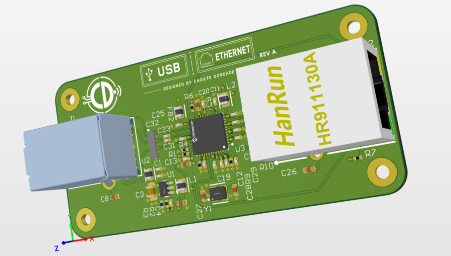
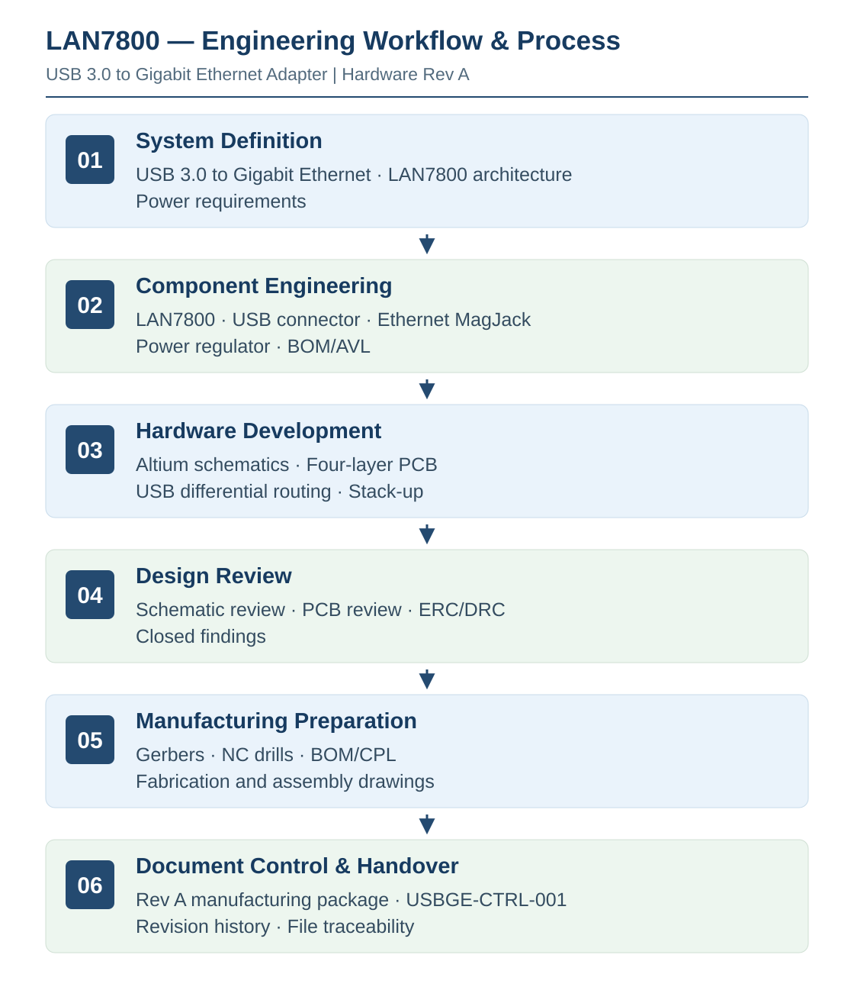
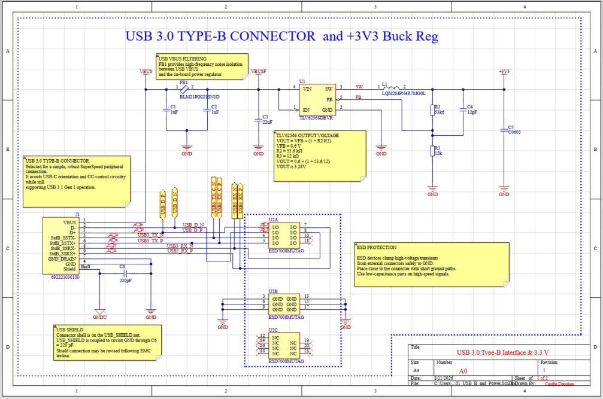
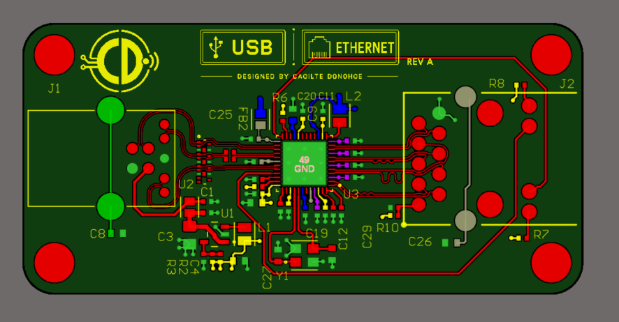
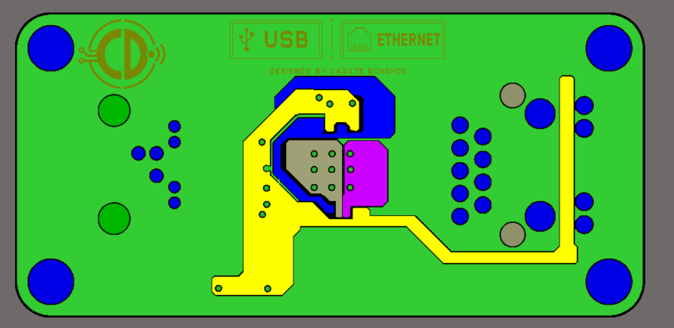

# LAN7800 — USB 3.0 to Gigabit Ethernet Adapter

I developed this LAN7800-based adapter in Altium Designer, taking it from system definition and component selection through schematic capture, four-layer PCB layout, design review and manufacturing documentation. The hardware revision is **Rev A**.

The completed schematic and PCB reviews are kept as separate records. The manufacturing package is supported by **USBGE-CTRL-001**, a five-sheet document-control register with document references, revision history and file traceability.

<p align="center">
  
</p>

*Altium 3D view of the Rev A design.*

## Engineering Workflow & Process



[Editable workflow SVG](Images/Portfolio/LAN7800_Engineering_Workflow.svg) · [Rev A manufacturing evidence](Manufacturing/) · [Document-control register](Manufacturing/USBGE-CTRL-001_Document_Control_Register.xlsx)

## 01 — System Definition

I defined the board around a USB 3.0 host connection and a Gigabit Ethernet interface using the Microchip LAN7800. The schematic separates the USB interface and power supply from the LAN7800 controller and Ethernet circuitry, making the interface and supply requirements easier to follow.

The two native schematic sheets are [USB and power](Hardware/Altium/01_USB_B_and_Power.SchDoc) and [LAN7800 and Ethernet](Hardware/Altium/02_LAN7800_Controller.SchDoc). The schematic extract below provides a readable view of the USB and power sheet. The full schematic PDF is retained locally because it contains workstation paths.

<details>
<summary>View the USB and power schematic extract</summary>



</details>

## 02 — Component Engineering

I selected the LAN7800, USB connector, Ethernet MagJack and power regulator as part of the same board-level design. The Rev A BOM records component specifications, footprints, manufacturer names, manufacturer part numbers and approval classifications. These fields provide the component-selection and BOM/AVL information for the project.

| Component area | Existing engineering evidence |
| --- | --- |
| LAN7800 controller and Ethernet MagJack | [Controller and Ethernet schematic](Hardware/Altium/02_LAN7800_Controller.SchDoc) |
| USB connector and power regulator | [USB and power schematic](Hardware/Altium/01_USB_B_and_Power.SchDoc) |
| BOM / AVL information | [Rev A component BOM](Manufacturing/01_BoM/LAN7800_USB_Ethernet_RevA_BOM.xlsx) |

## 03 — Hardware Development

I captured the schematics and developed the four-layer PCB in Altium. The layout brings the USB and Ethernet interfaces together with the controller support circuitry and power distribution. I used differential-pair routing rules, impedance profiles and matched-length constraints to guide the high-speed routing.



The [native PCB](Hardware/Altium/LAN7800_USB_Ethernet_RevA.PcbDoc), [stack-up specification](Manufacturing/07_Engineering/Stackup/USBGE-ENG-002_Stack_Impedance_Rules.pdf) and [layer-stack record](Manufacturing/07_Engineering/Stackup/USBGE-ENG-006_Layer_Stack.csv) document the implementation.

<details>
<summary>View the bottom layout and selected routing-rule evidence</summary>



- [Altium layer-stack configuration](Images/Design_Rules/01_Layer_Stack.PNG)
- [Impedance profiles](Images/Design_Rules/02_Impedance_Profiles.png)
- [Net classes](Images/Design_Rules/03_Net_Classes.png)
- [Differential-pair routing rules](Images/Design_Rules/05_Differential_Pair_Routing_Rules.png)
- [Matched-length rules](Images/Design_Rules/10_Matched_Length_Rules.png)

</details>

## 04 — Design Review

I documented the schematic review and PCB review separately. Both are revision **1.1**, dated **18 October 2026**, and record closed review status. The reviews use sectioned tables with a reference, review check, comments or evidence, and disposition, so the closure record remains attached to each check.

| Review record | Coverage and evidence |
| --- | --- |
| [Completed schematic review](Manufacturing/07_Engineering/Design_Review/LAN7800_Schematic_Review.docx) | Requirements and architecture, power, communications, external I/O, and manufacturing documentation |
| [Completed PCB review](Manufacturing/07_Engineering/Design_Review/LAN7800_PCB_Review.docx) | Board outline and stack-up, placement, power distribution, routing, grounding, and fabrication/assembly |
| Existing schematic ERC report | Retained locally; the original HTML contains workstation paths |
| Existing PCB DRC report | Retained locally; the original HTML contains workstation paths |

The [review folder](Manufacturing/07_Engineering/Design_Review/) contains the two completed review records. Their conclusions, evidence and dispositions are unchanged. The combined design-review PDF is retained locally because it contains workstation paths.

## 05 — Manufacturing Preparation

I organised the fabrication and assembly deliverables into the Rev A manufacturing package. The package includes the board artwork and drill data, component selection and placement records, and drawings for fabrication and assembly.

| Deliverable | File or folder |
| --- | --- |
| BOM / AVL information | [Rev A BOM workbook](Manufacturing/01_BoM/LAN7800_USB_Ethernet_RevA_BOM.xlsx) |
| Component placement | [CPL workbook](Manufacturing/03_CPL/LAN7800_USB_Ethernet_RevA_CPL.xlsx); the original CSV is retained locally because it contains a workstation path |
| PCB artwork | [Gerber X2 files](Manufacturing/02_GerberX2/) |
| Drill data | [NC drill files](Manufacturing/04_NC%20Drill/) |
| Fabrication drawing | [Rev A fabrication PDF](Manufacturing/05_Fabrication/LAN7800_USB_Ethernet_RevA_Fabrication.pdf) |
| Fabrication requirements | [USBGE-FAB-001](Manufacturing/05_Fabrication/USBGE-FAB-001_Fabrication_Instructions.pdf) |
| Assembly drawing | [Rev A assembly PDF](Manufacturing/06_Assembly/LAN7800_USB_Ethernet_RevA_Assembly.pdf) |
| Assembly inspection | [Inspection checklist](Manufacturing/06_Assembly/LAN7800_USB_Ethernet_RevA_Assembly_Inspection_Checklist.xlsx) |

The existing [test and quality folder](Manufacturing/08_Test_Quality/) contains procedures, traceability documents and blank inspection/test records. These are documentation deliverables; blank records are not presented as completed hardware tests.

## 06 — Document Control & Handover

I restructured the file inventory into [USBGE-CTRL-001 — Document Control Register](Manufacturing/USBGE-CTRL-001_Document_Control_Register.xlsx). It separates controlled engineering documents from generated manufacturing files and native source references, while keeping a revision-history record of the register changes.

| Worksheet | Purpose |
| --- | --- |
| **Document Control** | Project identification, document number, independent document revision, hardware Rev A, owner, status and approval fields |
| **Document Register** | Drawings, reports, procedures, reviews and specifications, with their recorded identifiers, revisions, statuses and locations |
| **Manufacturing Files** | BOM, CPL, Gerbers, drills and associated file checksums |
| **Source References** | Native Altium files referenced at their original location, explicitly external to the manufacturing package |
| **Revision History** | Document-control changes and the old/new register filename mapping |

The register is included unchanged as the control record for the complete Rev A package, rather than as an index limited to this public subset. Some register targets are intentionally omitted here or refer to local source versions not copied into this publication.

Relative file hyperlinks and SHA-256 checksums support file traceability. Legacy entry numbers retain the connection to the earlier inventory. Hardware **Rev A** is kept separate from each document's revision, and existing document statuses are preserved. The register is **Rev 1.0**, owned and prepared by **Caoilte Donohoe**, with status **For approval**. Formal review, approval and effective-date fields remain pending.

The authoritative editable design remains in [Hardware/Altium](Hardware/Altium/), including the [Altium project](Hardware/Altium/LAN7800_USB_Ethernet_RevA.PrjPcb). The complete manufacturing package references those source files without maintaining a second native-design copy. This publication leaves the already committed native source files unchanged.

```text
Hardware/Altium/                       Authoritative native design
Images/Portfolio/                     Editable LAN7800 workflow SVG
Manufacturing/
  USBGE-CTRL-001_Document_Control_Register.xlsx
  01_BoM/                             Component BOM
  02_GerberX2/                        PCB artwork
  03_CPL/                             Component placement
  04_NC Drill/                        Drill program and drill report; local-path .LDP omitted
  05_Fabrication/                     Fabrication drawing and requirements
  06_Assembly/                        Assembly drawing and inspection checklist
  07_Engineering/
    Design_Review/                    Separate completed schematic and PCB reviews
    Stackup/                          Stack-up documentation
  08_Test_Quality/                     Test procedures and quality records
```

**Designed by Caoilte Donohoe**
